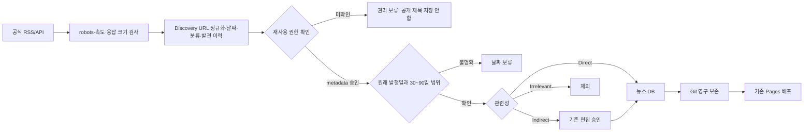

> **편집 기준 보완 후 최신 결과는 [EDITORIAL.md](EDITORIAL.md)를 참고하세요.** 아래 초기 12건은 뉴스·공시를 합한 보관 지표입니다. 최신 원장은 main의 통계 원자료 1건까지 보존한 13건이며, 기본 Newsroom 뉴스 7건·별도 공시 5건·연구용 통계 1건입니다.

# Tourism News News Engine v0.3

검증일: 2026-10-27 (한국시간). 이 PR은 main에 직접 병합하거나 기존 Pages를 교체하지 않습니다. 검증 DB의 확대와 현재 공개 서비스의 운영 상태를 구분합니다.

## 결과와 범위

- 기존 7개 스트림 유지, **14개 연결 추가**: 공개 재사용 조건이 확인된 API 스트림 9개와 발견 전용 RSS 5개입니다. API 9개는 **독립 제공자 2곳(SEC, GOV.UK)**의 기업별/분야별 스트림이며 9개 독립 언론사라고 계산하지 않습니다.
- 첫 검증: 응답 메타데이터 **705건**, 90일 범위의 중복 없는 발견 후보 **258건**, 신규 자동 게시 대상 **8건**, 기존 4건을 모두 유지해 검증 DB **12건**.
- 12건의 구성은 **뉴스 7건 + 기업 공시 메타데이터 5건**입니다. 공시를 언론 기사라고 표시하지 않습니다. SEC 항목은 제목의 `financial filing` 및 `record_type: regulatory_filing`으로 구분합니다.
- 신규 8건 중 4건은 30~90일 backfill입니다. 반복 실행은 신규 게시 0건이며 기존 결과를 중복해서 더하지 않습니다.
- 이번 검증에서 **원래 최근 24시간에 발행된 공개 가능 항목은 0건**입니다. 발견 258건 또는 새 DB 추가 8건을 “오늘 발행된 기사”로 홍보하지 않습니다. 기존 4건 문제의 원인은 스케줄 외에 공급량·권리·날짜·판별 범위에 있었으며, 일별 신선도 목표가 이미 달성됐다고 주장하지 않습니다.

상세 자료:

- [A. 수집원 조사표](SOURCES.md), [기계 판독용 조사표](source-audit.json), [실제 접근 증거](access-evidence.json)
- [첫 실행 지표](first-run.json), [반복 실행 지표](repeat-run.json)
- [공개 허용 검증 데이터 스냅샷](verified-publications.json): 운영 DB가 아닌 저장소 밖 실수집 검증 결과

## 구조: 발견과 게시 분리



`src/discovery.py`는 RSS/Atom, SEC 제출 인덱스, GOV.UK 검색 메타데이터 어댑터를 제공합니다. GDELT와 Federal Register의 메타데이터 파서도 테스트 가능한 형태로 준비했지만, 각각 접근/발행일 또는 활용 범위가 미확정이라 운영 소스로 임의 활성화하지 않았습니다. 발견한 원문 URL을 따라가 기사 본문·사진을 수집하지 않습니다.

`src/engine.py`는 발견 원장 → 권리/날짜 게이트 → 기존 `collector.run()` 게시 파이프라인을 연결합니다. private RSS도 source의 `enabled`는 발견 여부이며 `publication.status`가 별도의 게시 권한입니다. `approved + metadata_only + terms_url + basis`가 모두 있어야 게시 파이프라인에 넘깁니다. RSS 존재, HTTP 200, 접근 가능한 URL만으로 게시 승인하지 않습니다.

권리가 미확인된 RSS는 제목을 메모리에서 규칙으로 판별하고 URL·날짜·제목 해시·범주·보류 근거를 남깁니다. **Git 저장소도 공개될 수 있으므로 해당 제목은 discovery.json에 그대로 저장하지 않습니다.** 설명·본문·이미지는 저장·재게시하거나 AI로 가공하지 않습니다. 권리 확인 후 제공자가 다시 반환한 메타데이터부터 정상적으로 공개할 수 있습니다. URL과 제공자 정보로 보류 대상을 추적할 수 있습니다.

## 실제 연결과 권한

### 자동 게시 가능한 신규 연결

1. SEC EDGAR: Booking Holdings, Expedia Group, Marriott International, Hilton Worldwide, Delta Air Lines, United Airlines, Trip.com Group의 제출 인덱스.
   - [SEC 공식 FAQ](https://www.sec.gov/about/webmaster-frequently-asked-questions)는 정부 생성 콘텐츠와 EDGAR 공개 제출 콘텐츠의 자유로운 접근·재사용을 명시합니다. 이번 구현은 그보다 좁게 기업명·제출 유형·제출일·공시 URL 같은 인덱스 사실만 사용합니다.
   - 10-Q/10-K/20-F만 선택합니다. 개인 내부자 거래·임원 정보·임의 8-K/6-K를 산업 뉴스처럼 자동 확대하지 않습니다. 실제 공시 본문이나 첨부 보도자료는 가져오지 않습니다.
   - 90일 내 이번 확보는 Booking/Expedia/Marriott/Delta/United 각 1건입니다. Hilton/Trip.com은 응답 성공이지만 선택 가능한 기간·유형의 새 항목이 없었습니다. 0건도 그대로 기록합니다.
2. GOV.UK 관광·항공 공식 뉴스 검색 API.
   - [이용 조건](https://www.gov.uk/help/terms-conditions)은 다른 사이트/앱의 피드 사용과 OGL에 따른 콘텐츠 재사용을 안내합니다. 정부 뉴스 메타데이터만 사용하고 OGL 출처를 데이터 및 기존 설명 필드에 표시합니다. 제3자 사진이나 기사 본문까지 자유 이용이라고 가정하지 않습니다.
   - 공식 검색 인터페이스의 press_release 필터와 최대 100개 응답을 사용합니다. 임의 아카이브를 크롤링하거나 과거 페이지를 무제한 순회하지 않습니다.
   - 검색의 `public_timestamp`는 수정 시각일 수 있어 발행일로 게시하지 않습니다. 관련 후보에 한해 공식 Content API의 **first_published_at**만 확인합니다. API가 반환하는 본문은 읽어 분석·저장·재게시하지 않습니다. 날짜 조회는 스트림당 최대 10회/실행이고, 이미 확인한 최초 발행일을 캐시합니다.
   - 이번 항공 스트림에서 3건을 확보했으며 관광 스트림의 일반 문화·방문·지역 행사 제목은 건수를 늘리기 위해 게시하지 않았습니다.

### 발견 전용 및 미연결

- 대한항공/Trip.com IR/Hilton/Skift/연합뉴스 RSS는 실제 응답을 확인해 **발견 전용**으로 연결했습니다. 기업 실적 제목도 권한 미확인 상태에서는 자동 공개되지 않습니다. 이들 제목 원문은 공개 Git 원장에서 보류 처리합니다.
- 여행신문은 RSS 안내 및 기존 저작권 정책을 조사 대상으로 유지했습니다. 재사용 허락을 확보하지 않아 기사 피드나 본문 수집에 연결하지 않았습니다.
- IATA는 RSS 제공을 확인했지만 이용 조건의 재사용·AI 제한 때문에 미연결입니다. Accor도 확인된 재게시 제한을 우회하지 않습니다.
- 아시아나/한국은행의 조사 경로는 robots 제한으로 요청하지 않았습니다. 야놀자/모두투어/UN Tourism/GDELT 및 정책브리핑 일부 경로는 robots를 확인할 수 없어 후속 요청하지 않았습니다. 접근 실패를 원문 서버의 확정적인 차단이나 실제 API 403으로 바꿔 기록하지 않습니다.
- Marriott·Expedia·하나투어·여기어때·KTO 홈페이지 응답만으로 유효한 허용 뉴스 API가 있다고 판단하지 않습니다. 뉴스룸 접근과 SEC의 별도 공개 인덱스 이용도 구분합니다.

## 날짜·backfill·관련성

기존 Direct/Indirect/Irrelevant와 6개 카테고리는 유지했습니다. `RULE_VERSION`은 기존 승인 계약 0.2를 보존하고 새 영문/기업명 규칙 ID를 추가했으며 엔진/발견 스키마는 3입니다. 기존 Indirect 승인 파일과 제목 해시·원문 URL·검토일·근거 조건은 유지합니다. 라이선스 승인된 Direct는 관리자의 매일 기사 선택 없이 게시됩니다.

- ‘관광’이 없어도 기업명과 매출·영업이익·국제선·객실 공급 같은 변화가 함께 있으면 Direct를 검토합니다. 대한항공·제주항공·하나투어·야놀자와 글로벌 OTA/호텔/항공사 사례를 테스트했습니다.
- 일반 생일·할인 쿠폰·항공 진로 교육·지역 문화 행사를 수량 확보 목적으로 게시하지 않습니다. 영문 실적 뉴스 누락, 기업명만으로 판정하는 오탐, 숫자가 다른 별개 실적의 fuzzy 중복을 보완했습니다.
- URL 중복과 유사 제목 중복을 유지하되 서로 다른 수치가 담긴 기사는 유사 제목만으로 병합하지 않습니다.
- `first_discovered_at`, `first_published_by_engine_at`, `published_at`을 구분하며 재실행 시 앞의 두 값을 새 시각으로 덮어쓰지 않습니다.
- Atom의 `updated` 및 GDELT의 `seendate`를 발행일로 쓰지 않습니다. 수정일이 오래됐다는 정보는 오래된 후보를 제외하는 데만 쓰며 최신 발행을 주장하는 근거로 쓰지 않습니다.
- SEC filingDate는 원래 날짜를 유지하고 `date_precision: date`로 표시합니다. 모르는 시·분을 정확한 발행 시각이라고 주장하거나 최근 24시간 브리핑에 사용하지 않습니다.
- backfill은 제공자가 공식 API/피드에 실제로 반환한 30~90일 자료만 사용합니다. `--backfill-days`로 범위를 제한하며 더 오래된 데이터를 억지로 가져오지 않습니다. 이번 30~90일 backfill 4건은 8월 기업 공시 3건과 정부 항공 뉴스 1건입니다.
- 발견·게시 후보 선별은 최대 90일·4,500건이며 기존 보관 레코드는 최신 원장에서 삭제하지 않습니다. 기존 4건이 새 DB의 부분집합인지 확인했고 원형을 `collector_state/v02_snapshot.json`에 일회 보존합니다. 이번 PR은 운영 중인 site/data를 삭제하거나 검증 파일로 덮어쓰지 않았습니다.

최종 검증 범주: 관광정책 0 / 인바운드 1 / 여행산업 3 / 항공·숙박 6 / 문화·트렌드 2 / 경제·시장 0. 0인 범주를 일반 문화·경제 기사로 채우지 않았습니다.

## 성과 지표와 운영

각 실행은 다음을 남깁니다.

| 파일/필드 | 의미 |
| --- | --- |
| `collector_state/discovery.json` | URL 기반 후보·발견 이력·권리/날짜/관련성 결정. 미허가 제목은 해시만 보존 |
| `collector_state/source_metrics.json` | v0.3 시작 이후 소스별 시도·성공률·오류 종류 누적 |
| `collector_state/run_summary.json` | 이번 수신, 새 발견, 중복, 신규 자동 게시, 누적 게시, 24h/7d, 범주, backfill, record_type 집계 |
| `site/data/health.json.discovery` | 같은 지표를 운영 진단용으로 제공 |
| `src/report.py` → Actions Summary | 사람이 읽을 수 있는 실행·출처별 성과/오류 표 |

수신 705건은 provider가 반환한 장기 메타데이터를 포함합니다. 90일 밖과 범위 외 유형을 배제한 새 후보는 258건이며, 이들 중 관련성·날짜·권리 조건을 만족한 신규 게시 항목은 8건입니다. “발견”과 “게시”를 합산하지 않습니다. 실제 발행 최근 24h는 0, 7일은 4입니다. 반면 DB에 새로 추가한 시각 기준 24h/7d는 각각 8건으로 별도 표기합니다. 기간 원본이 날짜만 제공하면 intraday 집계에서 제외합니다.

정상 응답에 새 후보가 없는 경우 `no_new_candidate`, 발견됐지만 게시 불가하면 `discovered_not_publishable`, fetch 실패는 `fetch_failed`로 구분합니다. 성공한 출처도 0건일 수 있습니다. 일부 실패가 섞인 무신규와 전체 fetch 실패도 별도 outcome입니다. 기존 실행 17회의 성공률을 추정해 v0.3 누적치에 넣지는 않았습니다.

기존 2시간 간격·한국시간 10:30·workflow_dispatch·Git 저장·Pages 배포를 유지했습니다. manual 실행은 30/60/90일을 선택할 수 있으며 기본/예약 실행은 90일입니다. 바뀐 엔트리포인트는 `python src/engine.py`이고 기존 collector의 테스트·게시 로직은 유지합니다. 새 상태도 기존 `collector_state/*.json` 커밋·artifact 규칙에 포함됩니다.

robots의 Disallow/Crawl-delay/Request-rate를 확인하고, 리디렉션 대상도 다시 검사합니다. robots가 403/503 또는 HTML challenge면 허용으로 간주하지 않습니다. TLS·서명 검증을 끄거나 User-Agent/IP를 바꿔 차단을 우회하지 않습니다.

## 검증과 재현

- 기존 52개를 포함해 Python **83개 테스트 통과**.
- 새 테스트: 권리 미확인 Direct 차단/제목 비공개, 원래 발행일·수정일·발견일 분리, 90일 경계, 중복 재실행, UTC/KST 날짜, 공시 식별자·날짜 정밀도, 전체 실패 보존, v0.2 snapshot, 한국 관련 브리핑 우선순위, 영문·기업명·광고/일반 교육 오분류, robots 및 리디렉션/HTML challenge 차단.
- 실제 API/RSS 호출 결과는 JSON 증거로 보관했습니다. API 제공 자료만 사용했고 기사 원문 링크를 따라가 본문을 다운로드하지 않았습니다.
- 임시 Git 원격에 워크플로 저장 스텝을 실제 실행한 뒤 fresh checkout에서 공개 JSON과 새 발견/지표/보존 상태를 복원했습니다.
- actionlint 검증, 브라우저 Newsroom 검색·필터·저장·상세·브리핑·실패 보존, 기존 CSS/플랫폼 제목 불변을 확인했습니다.
- 기존 공개 Pages의 news.json은 실제 GET에서 4건을 반환했습니다. 이는 기존 main의 상태입니다. v0.3 12건은 같은 site 구조의 별도 로컬 서버에서 검증했으며 기존 사이트에 PR 코드를 임의 배포하지 않았습니다. PR CI는 테스트만 실행하고 게시 작업은 main 조건으로 건너뜁니다.

```bash
python3 -m unittest discover -s tests -v
# 실제 운영 파일과 분리해서 검증:
mkdir -p /tmp/tourism-v03-check
cp site/data/*.json /tmp/tourism-v03-check/
python3 src/engine.py --dir /tmp/tourism-v03-check --backfill-days 90
```

검증 JSON을 운영 폴더에 덮어쓰기보다, 승인·병합 후 기존 스케줄/수동 실행이 당시 최신 DB와 제공자 응답을 기준으로 수집하도록 합니다. 그 뒤 데이터 커밋·Pages artifact·공개 JSON의 원래 발행일/건수를 확인해야 v0.3 공개 게시 성공으로 판단할 수 있습니다.

## 다음 개발 과제

1. 민간 언론·기업의 메타데이터 재게시 허락 또는 정식 배포/검색 API 계약 확보. 권한 확인 후 manifest를 한 번 승인하면 Direct는 일별 편집 없이 운영할 수 있습니다. 현 상태의 발견 전용 RSS를 자동 게시했다고 주장하지 않습니다.
2. 한국 관광산업의 **당일 뉴스 공급** 확보. 이번에 늘어난 일부 항목은 분기 공시/backfill이며 이를 신선한 일일 뉴스 공급으로 대체해 설명하지 않습니다.
3. robots/API 접근이 확인되지 않은 GDELT·UN Tourism·한국은행·야놀자 등의 실제 허용 인터페이스 재검증. GDELT 날짜 보강도 라이선스가 있는 메타데이터 API로만 수행해야 합니다.
4. 키/비용이 필요한 공식 뉴스 검색·통계 API는 서비스 조건 및 예산 확인 후 추가. 현재 구현은 API 키·비밀번호 없이 작동하며 코드에 민감정보를 넣지 않습니다.
5. 기존 Newsroom의 450건 표시·검색 상한은 UX 변경 금지에 따라 유지했습니다. 현재 12건은 모두 표시되며, DB가 더 커지면 페이지네이션/검색 범위 확대를 별도 검토해야 합니다.
6. 더 큰 실제 라벨링 집합으로 영문·기업명 규칙의 정확도와 한국 시장 관련성을 검증. 소수 합성 반례의 통과율을 전체 정확도로 일반화하지 않습니다.
